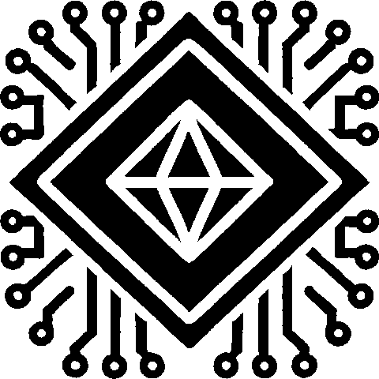
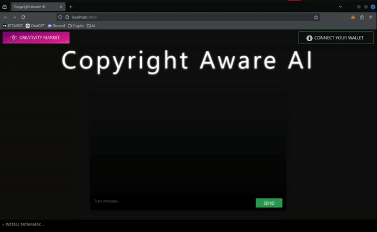
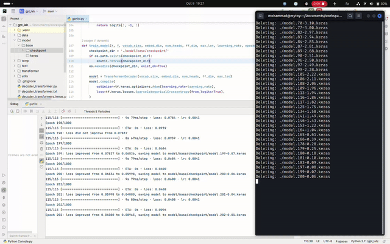
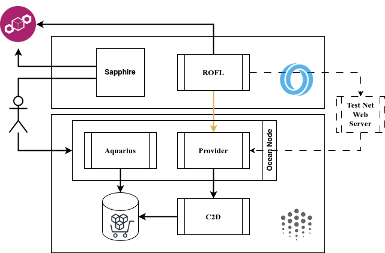

# Copyright Aware AI (CAAI)
Protecting and Monetizing Human Creativity with AI and Blockchain



## Project Description

This project aims to address a major concern surrounding artificial intelligence: the potential threat it poses to human creativity and originality. As AI rapidly improves, its ability to replicate creative works raises questions about copyright, originality, and fair compensation for creators. In response, this project proposes a model that leverages AI and blockchain to protect and monetize unique creative styles.

## Key Concepts

1. **Human Creativity and AI**: Humans possess unique thoughts and creative processes that AI currently lacks. However, AI can mimic artistic styles, potentially devaluing the originality that artists, musicians, and writers spend years honing.
2. **Monetizing Artistic Styles**: This project proposes a framework in which an artist’s unique style can be licensed and sold. Using AI, we train models on specific artistic styles, and users can purchase these models to generate new artwork in the licensed style. This approach protects artists' intellectual property and allows them to monetize their creativity.
3. **Broader Applications**: Beyond visual art, this approach extends to other creative domains such as music and literature, where creators can similarly protect and license their unique expressions.

## Solution Approach
Users can enhance their basic AI models with licensed creativity from the creativity store.

## Technical Architecture

The project’s technical infrastructure involves a secure and decentralized network leveraging Oasis and Ocean Protocols:

* **Oasis Sapphire Network**: A secure environment for submitting and storing requests on the blockchain.
* **Ocean Protocol**: Manages the purchasing and execution of creative styles, allowing anyone to host an Ocean node and participate in the creativity marketplace.

When a user submits a request, it’s stored securely on the Oasis blockchain. ROFL, the monitoring component, retrieves the request, which is processed via the Ocean Provider and C2D. The result is stored back on the blockchain for transparency and verification.

### Project Structure Description

- **`oceanprotocol/`**: Contains all configurations and files necessary to interact with the Ocean Protocol
  - **`data/`**: Contains a Decoder-Only Transformer [1], optimized model weights (`model.cat_story.zip`) [available for download here](https://t.me/CopyrightAwareAI/16), LoRA weights, and thumbnails.
  - **`papers/`**: Research papers related to [1] and the LoRA fine-tuning approach, that is essential for understanding the concepts behind this project.

- **`oasisprotocol/`**:
  - **`.cargo/`**: Cargo configuration files for dependency management.
  - **`oracle/`**:
    - **`tasks/`**: Contains task definitions for executing oracle operations.
    - **`contracts/`**: Smart contracts for the Oasis Sapphire network.
    - **`artifacts/`**: Compiled contract artifacts and build outputs.
    - **`typechain-types/`**: TypeScript type definitions for smart contract interaction.
  - **`src/`**: Source code for the Oasis protocol implementation.
  - **`target/`**: Build artifacts generated by Cargo.

- **`frontend/`**:
  - **`src/abis/`**: Contains ABI files for smart contract interactions.
  - **`src/assets/`**: Custom CSS/Images and other static assets.
  - **`public/assest/`**: Public assets directory with subdirectories for CSS and images.

### Dev Enviroment Setup Tips

**Install Rust**

```sh
sudo apt install bubblewrap gcc g++ gcc-multilib libclang-dev clang protobuf-compiler make cmake libssl-dev libseccomp-dev pkg-config
curl --proto '=https' --tlsv1.2 -sSf https://sh.rustup.rs | sh
rustup target add x86_64-unknown-linux-musl
sudo apt install musl-tools gcc-multilib clang
cargo install fortanix-sgx-tools
cargo install sgxs-tools
```

**OASIS Protocol Testnet** 

pay attention to `<ROFL *.orc PATH>`

```sh
docker stop $(docker ps -a -q)
docker container prune --force
docker volume prune --force
docker network prune --force
cargo clean
rm rofl-oracle.orc
oasis rofl build sgx --mode unsafe
docker run -it -p8545:8545 -p8546:8546 -v <ROFL *.orc PATH>:/rofls ghcr.io/oasisprotocol/sapphire-localnet
```

**Monitoring the ROFL logs**

```sh
while true; do docker exec -i $(docker ps -a -q) cat /serverdir/node/net-runner/network/compute-0/node.log | grep "rofl"; sleep 0.4; done
```

**Running Tests**

(in oracle directory)

```sh
pnpm hardhat test tests/aichat.test.ts`
```

**Compiling And Deploying Contract**

(in oracle directory)

```sh
pnpm hardhat compile; pnpm hardhat deploy rofl1qqn9xndja7e2pnxhttktmecvwzz0yqwxsquqyxdf --network sapphire-localnet
```

**Oceanprotocol Testnet**

```sh
git clone git@github.com:oceanprotocol/barge.git --depth 1
./start_ocean.sh --with-c2d  --no-dashboard
cd <DATA DIR>
python -m http.server 8080
```



## Conclusion

By leveraging AI and blockchain, this project offers a novel way to safeguard and commercialize creativity in a digital age, empowering artists and creators to benefit from their unique styles while fostering a fair and transparent creative economy.




